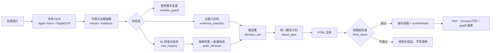

# 食品标签审核台 · Food Label Review Workbench

[](https://github.com/ccxcc065-a11y/food-label-review/actions/workflows/tests.yml)
[](LICENSE)
[](https://www.python.org)


本地运行的**预包装食品标签审核工作台**：上传同一销售包装的正/背/侧/喷码照片 → 本地 OCR → 字段与证据抽取 → 规则判定 → 输出可追溯的 HTML/PDF 审核报告。

**This repository contains code only.** It intentionally ships **no standards text, no regulation PDFs, and no real product photos**. Bring your own authorized corpus — see [Bring your own corpus](#bring-your-own-corpus). Without it the workbench still runs, and every clause-dependent judgement honestly reports **未检查／未覆盖 (not checked / not covered)** instead of guessing.

> 本仓库只含**程序**。不附带任何标准、法规正文与真实商品照片；语料需自备。没有语料时程序照常启动，所有依赖条款的判断如实显示「未检查／未覆盖」，不会编结论。

---

## 这是什么 / 不是什么

| 是 | 不是 |
|---|---|
| 一个**可运行的本地审核工作台**：OCR、字段抽取、营养表算术复核、证据链、裁定集、整改计划、HTML/PDF 报告 | 不是在线服务，不做云端上传（图片只在本机） |
| 一套**「宁可不下结论也不乱下结论」的工程实践**：三态字段、证据门槛、转致条款不冒充依据、成稿字节可校验 | 不是合规认证工具，**不能**替代监管判定或专业验收 |
| 面向 **GB 7718-2025 / GB 28050-2025** 口径设计的规则框架（2027-03-16 实施） | 不含标准正文，也**不承诺**任何准确率指标 |

**当前状态：工作副本 / 候选实现。** 端到端连续运行验收（内部代号 T20，五次连续完整审核）末次为 4/5，**未通过**；未做业务验收。详见 [Status & limitations](#status--limitations)。

---

## 为什么值得一读：把「准确」做成结构约束，而不是口号

LLM/OCR 类工具最危险的不是答错，而是**答错时语气一样肯定**。这个项目把"不虚报"写成七条可执行约束，并且都有测试或运行时断言：

1. **三态字段**：每一项只有 `已标 / 未标 / 无法识别`，另附证据块引用（图片、坐标）。"没识别到"永远不等于"没标"。
2. **没有依据就不下结论**：条款查不到时输出 `gap`（未覆盖）而不是 `pass`。少语料 → 少结论，不是多猜测。
3. **`partial` / `result-unknown` 不算成功**：AI 输出截断、超时、格式非法，一律记失败并写明原因，不记"完成"。
4. **本项证据门槛**：结论前先过 `{属性已定位, 标签已核验, 覆盖完整, 未见残缺文字}` 这类逐项门槛，未满足只能写"尚不能判定"，不能用全局布尔凑。
5. **转致条款 ≠ 依据**：像"按相关规定标示警示语"这种转致条款，只能作入口；实际缺陷必须绑定到真正的依据文档与条款，并校验该文档的 sha256 仍在授权清单内。
6. **成稿字节可校验**：报告保存前先检查最终 HTML（统计=正文=章节数、无残留标点、无未替换占位符），检查不过就不写成稿；PDF 从已存 HTML 生成，不重跑 AI。
7. **版本不虚标**：`programVersion` 只覆盖 `audit.py`，所以另外冻结判定链路 7 个模块与依据表的 sha256，并在结果里标记 `candidateConfig.published=false`。

这套约束的直接回报：**没有语料时，报告是一份诚实的"我查不了"清单，而不是一堆看起来很像结论的东西。** 仓库里 36 个离线测试（25 Python + 11 Node）就是从这些约束反推出来的。

---

## 技术亮点（30 秒版）

- **零运行时依赖**：Python 3.9+ 标准库起 HTTP 服务，前端零构建（原生 JS）。不 `pip install` 也能跑。
- **双 OCR 引擎**：macOS 走 **Apple Vision**（Swift 编译，本地离线），Linux 回退 **RapidOCR/ONNX**；识别结果带坐标进入证据链。
- **内容寻址**：规则包与成稿全部按 sha256 寻址；报告保存前先校验最终 HTML，通过才写盘，`contentHash` 可复核。
- **91 检查点账本**：每个检查点有状态（已实现/部分/未覆盖）与证据要求，结论与图片文字块双向可追溯。
- **可选 AI 只写解释**：事实、条款、数字由程序注入，AI 不得改写；失败或截断如实记失败，不进客户报告。
- **可测试的诚实性**：36 个离线测试专门覆盖「无依据弃权、`partial` 不算成功、转致条款不冒充依据」。

## 技术栈（分层）

| 层 | 选择 | 说明 |
|---|---|---|
| 服务 | **Python 3.9+ 标准库** `http.server` + 线程 | 无 Web 框架、无 ORM，`python3 server.py` 直接起 |
| 前端 | **零依赖原生 JS**，无构建步骤 | `index.html` / `app.js` / `report.js` 直接跑 |
| OCR | **Apple Vision（Swift，`swiftc` 编译）**；其它平台回退 **RapidOCR + ONNX Runtime** | 本地推理，不上传图片 |
| 存储 | **内容寻址 JSON**（bundle/request 带 sha256）+ **SQLite** 关系索引 | 发布包不可变、可复核 |
| PDF | **Chrome headless** 打印 + **pypdf** 盖章 | 复用已校验的 HTML，不二次渲染 |
| AI（可选） | **DeepSeek**（自备 key） | 只做自由解释；事实、条款、数字由程序注入，AI 不得改写 |
| 测试 | `unittest` + **Node 原生 `node --test`** 跑真实渲染 | 无测试框架依赖 |

代码规模约 1.3 万行 Python + 3 千行 JS（不含测试）。**没有任何第三方 Python 依赖**（除了可选的 Pillow/pypdf/RapidOCR）。

---

## 业务场景：谁需要它，省的是什么

| 角色 | 现在怎么干 | 用它之后 |
|---|---|---|
| 食品企业的标签 / 品控岗 | 逐条对照国标人工核对，改稿来回好几轮 | 上传正/背/侧/喷码照片，拿到「必改项 / 待核实项 / 已覆盖与未覆盖」清单 |
| 设计、代运营做上架前自查 | 靠经验或外部咨询 | 每轮改稿后自检，每条结论能点回原图，方便与工厂对齐 |
| 教学 / 研究 | 手工整理规则与判例 | 91 检查点与证据要求可直接当教材骨架 |
| 内部审核归档 | 结论散在邮件和聊天里 | 一份可复核的报告：证据块、条款号、版本与哈希都在 |

**它省的不是「判断」，而是「漏掉的项」和「说不清的依据」。** 每条结论都绑定图片文字块与条款号；拿不准的项显示「待核实 / 未覆盖」，不会伪装成通过。

### 用一句话讲给非技术同事

> 把标签照片丢进去，它会把「这次改稿可能漏了什么、依据是哪一条、我看不清的是哪几处」列清楚；它不会替你签字说「合规」。

## 能力边界（很重要，避免误用）

| 输入类型 | 本项目怎么处理 |
|---|---|
| 国产、直接面向消费者、**普通预包装食品** | 主路径：按 91 检查点审核并出报告 |
| 进口食品、小作坊、其他类别 | 分流人工，只提示专项核对项，不套用主路径结论 |
| 保健食品、特殊膳食、食用农产品、散装、现制现售 | **不适用**，不得把普通食品的结论套上去 |
| 版式类要求（字符高度、面积比例、色差） | 无矢量稿或实测时一律标「未校验」，不判合规 |
| 标准与法规正文 | **不随仓库分发**；缺语料时相关项显示「未覆盖」 |

> 因此**不能**说「能检测所有食品标签」。准确的表述是：**覆盖普通预包装食品标签的 91 项检查点，并按产品类型分流；不适用类别会明确拒绝套用**。

## 快速开始

```bash
git clone <this-repo> && cd food-label-review
python3 server.py --open           # 默认 http://127.0.0.1:8765
# 端口被占用时：python3 server.py --port 8766
```

- **macOS**：有 `swiftc` 时会自动编译 `ocr.swift` 并使用 Apple Vision
- **Linux/其它**：`pip install rapidocr onnxruntime` 走 RapidOCR
- **PDF**：需要本机 Chrome（缺失时如实标"PDF 不可用"，不影响 HTML 报告）
- **AI 复核**：设 `LABEL_REVIEW_API_KEY` 与 `LABEL_REVIEW_MODEL` 才启用；不设就是纯规则版

没有语料时你会看到一个"大量未覆盖"的报告 —— 这是**设计行为**，不是 bug。

```bash
python3 -m unittest discover -s tests -p "test_*.py"    # 25 tests, offline, ~0.2s
node --test tests/test_report.js                       # 11 tests, front-end rendering
```

---

## Bring your own corpus

程序通过 `knowledge/` 下的**元数据**工作，`documents/` 放你自己的授权文本：

```
knowledge/
├── rules.json       # 规则 → 条款号 / 页码 的映射（元数据，已含）
├── manifest.json    # 授权文件清单：文件名 + sha256（元数据，已含）
├── coverage.json    # 条款覆盖状态（元数据，已含）
├── exclusions.json  # 报告 08 节的排除说明模板（已含）
├── grades.json      # 质量等级标准清单（已含）
└── documents/       # ← 你自己放授权取得的 PDF/DOCX，本仓库不含
```

1. 把授权文本放进 `knowledge/documents/`（文件名与 `manifest.json` 一致，sha256 也要对得上）
2. 重新构建知识包：`python3 -c "import registry; registry.default_registry().publish(editor='you', reason='local corpus', knowledge_source='rebuild')"`
3. 重启服务。此时条款检索才有内容，结论才会从「未覆盖」变成「已核验/待核」

`knowledge/manifest.json` 只登记文件名与哈希；**没有任何标准正文**。引用的文件名列表本身就是公开信息，可以安全提交。

---

## 测试

```bash
python3 -m unittest discover -s tests -p "test_*.py"   # 25 tests
node --test tests/test_report.js                       # 11 tests
```

合计 **36 个离线测试**。

离线测试覆盖四块，都**不需要语料、不需要服务、不联网**：

| 模块 | 覆盖 |
|---|---|
| `test_clause_slicer.py` | 条款切片器三条通用规则：行首才算条文、行中引用不切、条号必须单一升序（`PARSE_VERSION = clause-index-4`） |
| `test_honesty_invariants.py` | 无依据时**必须弃权**：没有 `pass`、检查点无「通过」、R14 缺依据表时标未覆盖、分类计数与条目一致、候选配置标记未发布 |
| `test_extract_and_report_safety.py` | 字段抽取与证据引用；坐标/编号非法直接拒绝；`html_check` 拦截残留标点与未替换占位符 |
| `test_report_punct_join.py` | 用 Node 真实渲染报告，断言多条"待核对"原因拼接不产生 `。；` 这类会让成稿被拒的残留 |

> 依赖授权语料与真实样例图的集成/验收套件不在本仓库（无法合法分发语料），只在私有工作副本中运行。这是刻意的取舍，不是遗漏。

---

## 仓库结构

```
├── server.py             # HTTP 入口（/api/ocr /api/extract /api/report /api/health …）
├── audit.py              # 审核主流程：字段、营养算术、逐项判定、证据门槛
├── extract.py            # 文字块 → 结构化字段 + 营养表
├── evidence.py           # 图片归属、覆盖、锚点
├── evidence_checklist.py # 证据清单三态机
├── clause_index.py       # 条款切片器（行首/引用/升序三规则）
├── audit_retrieval.py    # 条款检索与引用校验（转致条款不得当依据）
├── decision_set.py       # 裁定集：审批必须绑内容寻址 candidateId
├── report_plan.py        # 统一整改计划（02/03/06/07 同源）
├── report_render.py      # 服务端 HTML 渲染
├── report_check.py       # 成稿前的渲染后检查
├── html_check.py         # 检查规则（统计/标题/残留/截断/占位）
├── registry.py           # 内容寻址发布包（bundle）+ 版本
├── rule_registry.py      # 91 检查点账本与结果映射
├── snapshot.py           # 快照指纹（输入 + 依赖版本）
├── runtime_agents.py     # 可选 AI 复核与撰稿（契约式，事实由程序注入）
├── knowledge.py          # 条款检索与引用解析（要求 sha256 一致）
├── ocr.swift             # Apple Vision OCR
├── report.js / app.js    # 前端渲染（零依赖）
├── checkpoints.json      # 91 检查点（机器可读）
├── knowledge/            # 仅元数据，无标准正文
├── scripts/              # 工具脚本（依据表生成、切片自检）
└── tests/                # 25 个离线测试
```

架构图（GitHub 直接渲染）：



---

## Status & limitations

- **未通过**连续运行验收（T20 末次 4/5）；**未**做业务验收；四个已知阻断项（条款切片独立核验、91 项分类定稿、转致条款覆盖、真值底稿封存）尚未全部关闭。
- 不含标准正文；没有语料时结论一律为"未覆盖"，这是**设计**，不是能力声明。
- 版式类要求（字符高度、面积比例、黑体、色差）**无法**从普通照片判定，程序只会标"未校验"并要求矢量稿或实测。
- 跨平台 OCR 结果存在差异（Apple Vision vs RapidOCR），密集营养表尤其明显；不同引擎的读数不应互相当作复核。
- AI 复核是可选项：它只产出自由解释，事实与条款由程序注入；AI 失败/截断如实记失败，不进入客户报告。
- 仓库**不含**任何真实企业名称、地址、许可证号或商品照片（示例数据均为虚构）。

---

## 中文摘要

这是一个本地运行、离线优先的食品标签审核工作台。它把"不要虚报"写成了结构：字段三态、无依据弃权、证据门槛、转致条款不冒充依据、成稿字节可校验、版本不虚标。技术上刻意用最少依赖（Python 标准库起服务、零依赖前端、Apple Vision 本地 OCR、内容寻址存储），因此 clone 下来就能跑。仓库只含代码，标准与法规正文需自备；没有语料时它会诚实地告诉你"这条我查不了"。

---

## License

MIT — 见 [LICENSE](LICENSE)。

第三方标准、法规文本、商品图片**不**在本许可证范围内，也不随本仓库分发。使用本项目审核真实产品前，请自行取得所依据标准的合法副本，并对结论承担专业复核责任。
