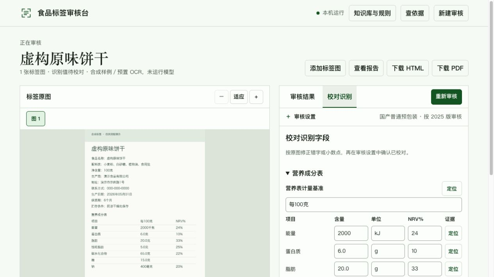
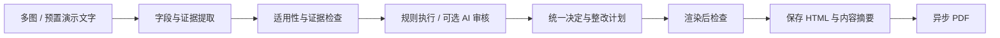

# 食品标签审核台 · Food Label Review

[](https://github.com/ccxcc065-a11y/food-label-review/actions/workflows/tests.yml)
[](LICENSE)
[](https://www.python.org)

把同一商品的包装图片整理成可校对的字段、逐项检查记录和 HTML/PDF 报告。面向普通预包装食品的内部初审场景，当前是个人项目原型。

**先看效果：** [两分钟操作路线](docs/demo.md) · [合成样例报告](docs/demo-report.html) · [工程取舍与案例](docs/engineering-notes.md) · [验证范围](docs/validation.md)



> 截图使用虚构商品和预置 OCR。程序实际执行字段提取、规则与报告流程；没有运行 OCR 或云端模型，也没有导入标准正文。它展示操作能力，不代表法规审核已经通过。

## 这个项目解决什么问题

标签初审不仅是识别文字。正反面信息分散，小数点可能识别错，缺少一张照片也可能被误当成标签漏标。审核人员需要能回到原图校对，并知道每项结论用了什么证据。

项目起点是一道食品标签审核工具题。我负责需求拆解与验收口径，借助 AI 编程工具完成实现和迭代。重点是把模糊需求转成可验证的行为：

- **先处理输入：** 一个商品支持多图，字段保留图片块引用，校对值与原始观察分开记录。
- **约束判断：** 规则执行、AI 候选和人工决定分工；已标、未标、无法识别分别处理。
- **交付可核对的结果：** 91 个检查点记录覆盖状态，报告统计与整改计划共用决定数据，下载保存的成稿字节。

当前没有客户生产部署或人工封存的准确率评测集。[案例复盘](docs/engineering-notes.md)说明做过的取舍及尚未验证的部分。

## 快速体验（无需 OCR、标准文本或模型 key）

需要 **Python 3.9+、Node.js 20+**。Node 用于生成 HTML 报告。

```bash
git clone https://github.com/ccxcc065-a11y/food-label-review.git
cd food-label-review
python3 -m venv .venv
source .venv/bin/activate
python -m pip install -r requirements.txt
python server.py --demo --open
```

Windows 激活虚拟环境使用 `.venv\Scripts\activate`。也可不加 `--open`，手动打开终端显示的地址（默认 `http://127.0.0.1:8765`）；换端口用 `--port 8766`。

1. 点击「虚构原味饼干」，载入自制标签与预置文字。
2. 切到「校对识别」，查看七行营养数据；点击「定位」回到图片区域。
3. 查看审核结果和 HTML 报告。缺少授权依据的项目保持未检查／未覆盖。
4. 点击「重新审核」创建新报告；下载已有报告读取原成稿。

`--demo` 在服务端禁用 OCR 和云端 AI，即使本机已有模型 key 也不会调用。演示数据不是准确率金标准，也没有模拟真实标准来伪造通过结论。

如果本机之前导入过知识库，演示仍使用当前本地发布版；“没有标准正文”指全新检出的默认状态，不由 `--demo` 强制清空已有资料。

## 用自己的图片

去掉 `--demo` 启动。macOS 需要 Xcode Command Line Tools 的 `swiftc`，使用本机 Apple Vision；其他平台可另装 `rapidocr onnxruntime`。图片识别与默认规则处理在本机执行。

HTML 报告需要 Node；PDF 另外需要 Chrome/Chromium，使用 pypdf 添加报告编号和页码。缺少 PDF 条件时不影响 HTML。

可选模型配置见 [配置说明](docs/configuration.md)。正常审核可调用 AI 审核与整改撰稿；AI 候选需校验，确定结论及关键数字不能由自由文案改写。此分支仍有超时和输出截断问题，尚未完成连续运行验收。

## 审核流程与关键取舍



| 取舍 | 原因 | 实现入口 |
|---|---|---|
| 算术和证据门槛交程序；AI 产生候选与解释 | 可重复计算，保留模型语义错误的处理入口 | [audit.py](labelreview/audit.py)、[runtime_agents.py](labelreview/runtime_agents.py) |
| 检查目录与实际完成状态分开 | 没有发现不能自动等于通过 | [rule_registry.py](labelreview/rule_registry.py) |
| 候选批准绑定内容、证据和版本 | 避免上一轮批准套到下一轮另一条建议 | [decision_set.py](labelreview/decision_set.py) |
| 保存后读取同一份成稿 | 查看、下载不重新调用模型；内容可用 SHA-256 核对 | [report_api.py](labelreview/report_api.py) |

91 是检查目录数量，**不是 91 项自动审核均已完成**。当前元数据分类为 2 项已有、68 项部分、21 项缺失；“已有”也不等于业务验收通过。[完整目录](checkpoints.json)

## 自备授权知识库

仓库发布代码、规则元数据和自制样例，**不分发标准／法规正文、真实商品图片或企业资料**。MIT 许可不覆盖第三方内容。

有授权文本时，按 [知识库接入说明](docs/configuration.md#授权知识库)重建本地发布包。没有语料时仍能体验提取与报告，但条款相关判断保持未覆盖。个人开发环境中的语料统计不作为这个公开版本的效果指标。

## 验证

```bash
python -m unittest discover -s tests -p 'test_*.py' -v
node --test tests/test_report.js
# 无语料干净检出：另一个终端先启动 --demo，再检查真实 HTTP 流程：
python scripts/check_demo.py http://127.0.0.1:8765
```

当前公开测试：**30 项 Python + 12 项 Node**，另有独立 HTTP 演示冒烟检查。CI 在 Python 3.9/3.11、Node 20 上运行，并从干净检出启动演示、检查网页资源、提取七行营养数据、生成并校验下载 HTML。

这些验证覆盖发布完整性、提取和报告约束，**不证明法规准确率、实拍 OCR 准确率或 AI 稳定性**。已完成与未完成的测试见 [验证记录](docs/validation.md)。

## 当前限制

- 无封存的人工真值集，不提供准确率数字。
- 连续真实 AI 审核末次记录为 4/5，未通过；一次调用实测输入约 166k token，发生超时，输入组织仍需优化。
- 混图判定、版式核验及各类食品专项规则仍有未覆盖范围。
- 进口、特殊膳食等不套用普通食品结论，需专项人工处理。
- 公开演示没有标准正文，不能直接拿来出具真实产品合规结论。

## 项目结构

`labelreview/` 包含提取、规则、依据、决定与报告模块；`app.js` 和 `report.js` 为无构建步骤的前端；`agents/` 保存两个活跃角色的契约；`knowledge/` 仅元数据；`demos/` 为自制演示输入；`tests/` 与 `scripts/check_demo.py` 验证公开分发路径。

代码使用 [MIT License](LICENSE)。
