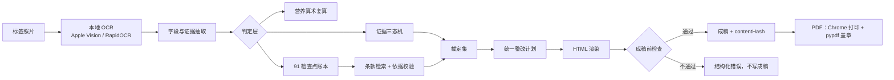

# 食品标签审核台 · Food Label Review Workbench

[](https://github.com/ccxcc065-a11y/food-label-review/actions/workflows/tests.yml)
[](LICENSE)
[](https://www.python.org)


本地运行的**预包装食品标签审核工作台**：标签照片 → 本地 OCR → 字段与证据抽取 → 规则判定 → 可追溯的 HTML/PDF 报告。

面向**国内生产、直接面向消费者的普通预包装食品**。仓库只含程序：不含标准与法规正文，不含真实商品照片，也不承诺准确率（没有封存的人工真值集）。条款依据需自备授权文本。

> Code only — no standards text, no regulation PDFs, no product photos. Bring your own authorized corpus; without it the workbench still runs and every clause-dependent judgement reports 未检查／未覆盖.

---

## 输出长什么样

**有语料时**（真实输出，合成标签，已启用知识包）：

```json
{"id": "F04", "outcome": "review", "title": "日期标示需补充",
 "source": "4.7.1、4.7.2、10.1～10.3、附录 A.2",
 "detail": "当前资料未确认保质期到期日。2025 版一般要求生产日期及到期日。保质期至少 6 个月…"}

{"id": "GB7718AL", "outcome": "review", "title": "致敏物质标示待核对",
 "source": "4.12、10.3、附录 D",
 "detail": "当前配料文字涉及「小麦粉」。原料名称线索还需区分直接投料、复合配料及深加工来源…"}
```

**没有语料时**（本仓库默认状态，可直接复现）：

```json
{"id": "R14", "outcome": "gap", "title": "警示语检查缺少依据表，本条未检查",
 "detail": "本次运行读不到警示语依据表，4.14 按未检查／未覆盖处理，不得视为通过。"}
```

同一套代码，差别只在有没有授权语料。结论只有 `pass / issue / review / gap` 四种，**不存在"没有记录但算通过"**。

---

## Features

- **本地优先**：Python 3.9+ 标准库起 HTTP 服务，前端零构建（原生 JS）。OCR 在 macOS 走 Apple Vision（`swiftc` 编译），其它平台回退 RapidOCR；图片不出本机。
- **条款级知识库**：切片器 `clause-index-4` 把授权文本切成条款级单元——10,107 条条款、1,241 张表、855 条条文、825 个章节，合计 13,362 片。发布包内容寻址，取文时校验文件 sha256。
- **91 检查点账本**：45 条规则全部有代码实现；每个检查点记录授权依据、适用条件、执行方式与覆盖状态（当前 2 已有 / 68 部分 / 21 缺失；程序 64 / 人工 13 / 未实现 14）。
- **证据可追溯**：字段三态（已标 / 未标 / 无法识别）＋ 图片块引用；不同结论要求不同证据，例如营养项需要 `value/unit/basis/printedNrv/reference/rounding`，净含量只要 `value/unit`。
- **成稿前检查**：对最终 HTML 校验统计与章节数、残留标点、未替换占位、截断主体名；通过才写盘并记录 `contentHash`。PDF 从已保存 HTML 生成，不重跑 AI。
- **可选 AI 只写解释**：事实、条款、数字由程序注入，AI 不得改写；失败、超时、输出截断一律如实记 `failed`。
- **可测试**：36 个离线测试（25 Python + 11 Node），CI 覆盖 Python 3.9 / 3.11 与 Node 20。

## How it works



## 快速开始

```bash
git clone <this-repo> && cd food-label-review
python3 server.py --open           # 默认 http://127.0.0.1:8765
# 端口被占用时：python3 server.py --port 8766
```

- **macOS**：有 `swiftc` 时自动编译 `ocr.swift` 并使用 Apple Vision
- **Linux / 其它**：`pip install rapidocr onnxruntime` 走 RapidOCR
- **PDF**：需要本机 Chrome；缺失时如实标「PDF 不可用」，不影响 HTML 报告
- **AI 复核**：设置 `LABEL_REVIEW_API_KEY` 与 `LABEL_REVIEW_MODEL` 才启用，不设就是纯规则版

## Bring your own corpus

程序通过 `knowledge/` 下的**元数据**工作，授权文本放 `documents/`：

```
knowledge/
├── rules.json       # 规则 → 条款号 / 页码 的映射（元数据，已含）
├── manifest.json    # 授权文件清单：文件名 + sha256（元数据，已含）
├── coverage.json    # 条款覆盖状态（元数据，已含）
├── exclusions.json  # 报告 08 节的排除说明模板（已含）
├── grades.json      # 质量等级标准清单（已含）
└── documents/       # ← 你自己放授权取得的 PDF/DOCX，本仓库不含
```

1. 把授权文本放进 `knowledge/documents/`（文件名与 `manifest.json` 一致，sha256 也要对得上）
2. 重建知识包：`python3 -c "from labelreview import registry; registry.default_registry().publish(editor='you', reason='local corpus', knowledge_source='rebuild')"`
3. 重启服务。条款检索才有内容，结论才会从「未覆盖」变成「已核验 / 待核」

`manifest.json` 只登记文件名与哈希，没有任何正文；文件名清单本身是公开信息。

## 测试

```bash
python3 -m unittest discover -s tests -p "test_*.py"   # 25 tests
node --test tests/test_report.js                       # 11 tests
```

离线、无需语料、无需服务、不联网。覆盖四类：条款切片器规则（行首 / 引用 / 升序）、
无依据时必须弃权（无 `pass`、检查点无「通过」）、字段抽取与成稿安全检查、
报告标点拼接（Node 真实渲染）。

依赖授权语料与真实样例图的集成套件不随仓库发布，只在私有工作副本运行。

## 仓库结构

扁平包是有意为之：整条判定链在一个进程里自上而下读，模块都是函数库，不套框架。

```
├── server.py                 # 入口：python3 server.py --open
├── labelreview/              # 全部逻辑（36 个模块）
│   ├── server.py             #   HTTP 路由与静态资源
│   ├── audit.py              #   审核主流程：字段、营养算术、逐项判定、证据门槛
│   ├── extract.py            #   文字块 → 结构化字段 + 营养表
│   ├── evidence.py           #   图片归属、覆盖、锚点
│   ├── evidence_checklist.py #   证据清单三态机
│   ├── clause_index.py       #   条款切片器
│   ├── audit_retrieval.py    #   条款检索与引用校验
│   ├── decision_set.py       #   裁定集：审批绑内容寻址 candidateId
│   ├── report_plan.py        #   统一整改计划
│   ├── report_render.py      #   服务端 HTML 渲染
│   ├── report_check.py       #   成稿前渲染后检查
│   ├── html_check.py         #   检查规则
│   ├── registry.py           #   内容寻址发布包 + 版本
│   ├── rule_registry.py      #   91 检查点账本与结果映射
│   └── …                     #   knowledge / snapshot / runtime_agents / typography …
├── report.js / app.js        # 前端（零依赖、无构建）
├── index.html / admin.html   # 工作台与管理页
├── checkpoints.json          # 91 检查点（机器可读）
├── knowledge/                # 仅元数据
├── scripts/                  # 工具脚本
└── tests/                    # 离线测试
```

## 适用与不适用

| 输入类型 | 处理方式 |
|---|---|
| 国产、直接面向消费者、普通预包装食品 | 主路径：按 91 检查点审核并出报告 |
| 进口食品、小作坊、其他类别 | 分流人工，只提示专项核对项 |
| 保健食品、特殊膳食、食用农产品、散装、现制现售 | 不适用，不套用普通食品结论 |
| 版式要求（字高、面积比例、色差） | 无矢量稿或实测时一律标「未校验」 |

## Roadmap / 已知缺口

- **发布包不在仓库内**：仓库只带元数据，条款正文与已发布 bundle 需自备（法律原因）。
- **21 个检查点未覆盖**：见 `checkpoints.json` 中 `coverageStatus = missing` 的条目。
- **无人工真值集**：因此不给准确率数字。
- **连续运行验收**：末次 4/5 未通过；失败模式为 AI 输出截断、超时、结果未知。
- **跨平台 OCR 差异**：Apple Vision 与 RapidOCR 在密集营养表上读数不同，不能互相「复核」。
- **AI 复核稳定性**：166k prompt 会触发 300s 超时，提示词压缩未完成。

## Related projects

- [Docling](https://github.com/docling-project/docling)：通用文档解析（PDF/DOCX/图表），本项目不做通用解析。
- [invoice2data](https://github.com/invoice-x/invoice2data)：票据字段抽取，思路相近（模板 + 校验），领域不同。
- [PaddleOCR](https://github.com/PaddlePaddle/PaddleOCR) / [RapidOCR](https://github.com/RapidAI/RapidOCR)：本项目在非 macOS 平台的 OCR 依赖。
- Apple Vision：macOS 上的本地 OCR。

## Status

工作副本 / 候选实现，未通过连续运行验收，未做业务验收。不构成合规结论，不能替代监管判定或专业复核。

## License

MIT，见 [LICENSE](LICENSE)。

第三方标准、法规文本与商品图片不在本许可范围内，也不随仓库分发；使用本项目审核真实产品前，请自行取得所依据标准的合法副本，并对结论承担专业复核责任。
