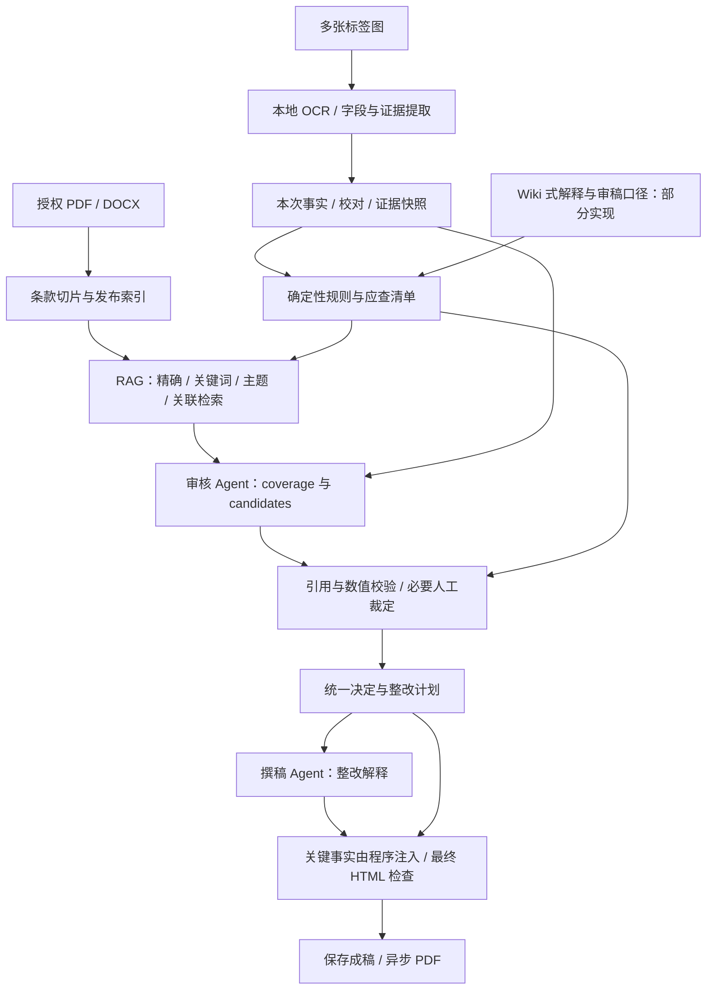

# Agent 协同与 RAG＋Wiki 知识架构

本项目是规则与证据约束下的领域审核 Agent 工作台。当前采用程序编排的两个模型角色，不把 OCR、计算器或报告渲染器都称作 Agent。

## 1. 哪些步骤真正调用 Agent

这里的 RAG 检索由程序执行，再把检索结果交给审核 Agent；没有实现模型自主多轮调用检索工具的循环。Wiki 式解释与审稿口径也不具备自主发布权限。

| 执行步骤 | 代码与契约 | 可核对的行为 |
|---|---|---|
| 准备 RAG 上下文 | [audit_retrieval.py](../labelreview/audit_retrieval.py) 的 `retrieve_for_item`、`prepare_audit_task`、`model_payload` | 根据产品事实和检查项找条款，附上原文、定位、摘要及证据 ID；不只读取规则原先引用的条款 |
| 审核 Agent 调用 | [runtime_agents.py](../labelreview/runtime_agents.py) 的 `run_ai_review`；[角色文件](../agents/ai-review.md) | 调用配置模型，要求逐项返回 coverage，可选返回候选；没有候选不等于通过 |
| 决定与交接 | [report_api.py](../labelreview/report_api.py)、[decision_set.py](../labelreview/decision_set.py) | 校验候选与当前证据／版本，处理批准，形成可追溯决定和整改计划 |
| 撰稿 Agent 调用 | `build_remediation`；[角色文件](../agents/remediation.md) | 仅对已确认且有编辑动作的条目生成 explanation；没有合格动作时不调用模型 |
| 最终输出 | [report_plan.py](../labelreview/report_plan.py)、[report_render.py](../labelreview/report_render.py)、[html_check.py](../labelreview/html_check.py) | 组合决定与文案，检查实际 HTML；保存后读取原成稿，不因查看而重跑模型 |

两个角色默认可使用同一个服务商和模型，但输入、权限、输出契约与调用记录不同。角色数不代表独立模型数量，也不意味着每份报告一定有两次模型调用。

## 2. 多 Agent 协同靠什么

审核 Agent 返回“查了什么、怀疑什么、缺什么证据”；撰稿 Agent 接收经校验的决定及允许动作。交接绑定 `snapshotId / evidenceVersionId / planVersion / itemId / actionId`，候选批准另外绑定内容寻址身份。

- 事实与依据由程序准备，Agent 输出按候选处理。
- 可计算的问题由确定性代码核对，涉及语义与例外的事项仍可能需要人工。
- 撰稿不能直接把待核实改成确定问题，也不能把须整改改成通过。
- JSON 合法、条款存在，只证明结构或引用可核对，不证明全部自然语言语义正确。
- 代码有拒绝、待核实及模板回退路径；公开 CI 没有证明复杂跨角色争议都已形成完整闭环。

## 3. RAG：原文检索层

授权文件经过条款切片，保存条款身份、原文位置及内容摘要。查询包括条款号精确定位、关键词、主题命中和关联条款展开，代码入口是 [knowledge.search_clauses](../labelreview/knowledge.py) 与 [clause_index.py](../labelreview/clause_index.py)。当前实现不用向量数据库。

检索结果与标签事实一起进入审核模型，是本项目的检索增强生成路径。知识发布包和任务版本用于约束本次使用的依据。取不到授权原文，相关判断保持依据不足，不由模型常识补齐。

定义、例外、附表检索路径已经存在，但检索召回是否完整、条款边界是否正确仍需要标注集验证，不能由“已经接入 RAG”推导准确率。

## 4. Wiki：受控解释与审稿知识整理层

设计上，Wiki 式层回答“这条要求怎么理解、适用于什么情况、有什么例外、报告应该怎样表达”。它与原文检索分工：解释帮助使用原文，不能冒充原文。

**当前是部分实现：**

- [interpretations.py](../labelreview/interpretations.py) 保存少量结构化核定解释，字段包含条款身份、适用条件、要求、状态和核验信息；目前只有一个登记条目。
- [notes.py](../labelreview/notes.py) 提供审稿说明的检测与模板入口；`knowledge/review_notes.json` 内容未随公开仓库分发，因此默认没有这份完整笔记库。
- [registry.py](../labelreview/registry.py) 在发布组合中保存 interpretations 和审稿模板；模型输入也有显式审稿口径。尚需验证各消费者使用同一发布版本的完整一致性。

**尚未实现：** 从整库自动生成完整 Wiki、独立知识页管理与修订回链、自动更新、完整冲突处理，以及这些功能的业务验收。因此不能把公开版描述为“完整 LLM Wiki 已搭好”或“知识库会自动学习并自行发布”。

后续建设应从可编辑、可审核、能回到原文的知识页开始，每次改动形成新版本；摘要或经验笔记的变更不能悄悄改变历史报告。

## 5. 正常 Agent 模式与公开演示

| 模式 | 实际运行内容 | 需要什么 |
|---|---|---|
| 公开 `--demo` | 预置 OCR → 提取 → 规则／缺依据处理 → 真实生成 HTML；服务端关闭模型 | Python、依赖、Node；不需要 OCR、key 或标准正文 |
| 正常规则模式 | 本机 OCR、字段校对、规则、报告 | 本机 OCR；条款判断另需授权依据 |
| 正常 Agent 模式 | 规则 → 检索上下文 → 审核 Agent → 校验与决定 → 有合格动作时撰稿 Agent → 报告 | 配置模型、相应授权语料，以及允许发送这些资料的使用范围 |

公开测试能验证契约的部分约束与无语料路径；历史真实 AI 连续运行验收为 4/5，未通过。本次文档补全没有重新调用付费模型，也没有把演示包装成真实 Agent 验收。
