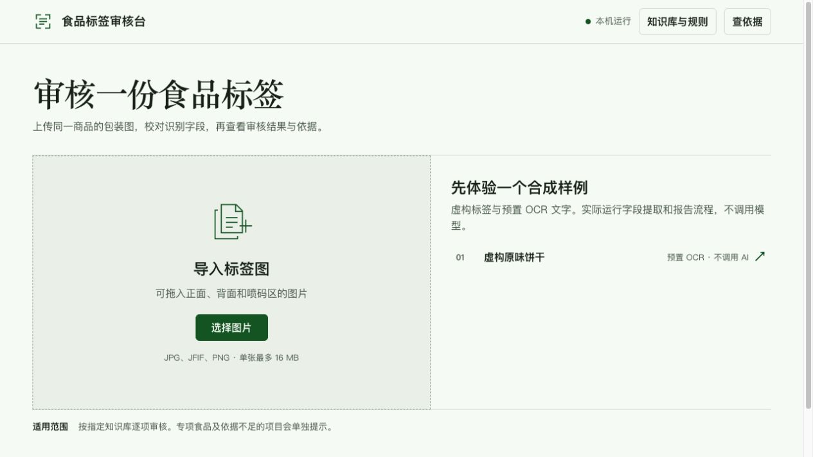
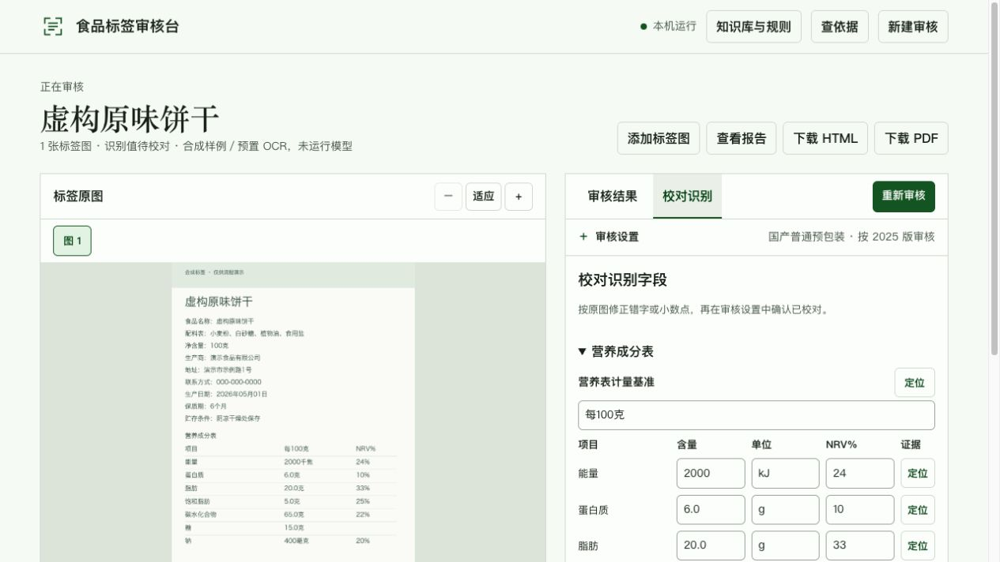
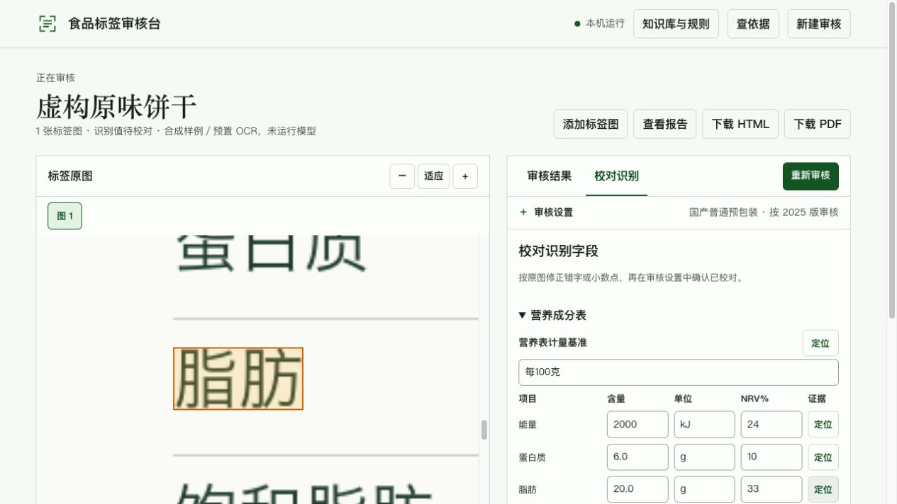

# 两分钟体验：合成标签到可下载报告

启动命令见 [README](../README.md#快速体验无需-ocr标准文本或模型-key)。本路线使用 `--demo`，没有 OCR 引擎、模型 key 或标准正文也能运行。

## 0:00 导入

点击「虚构原味饼干」。[图片](../demos/synthetic-label.png)由项目脚本绘制，[预置 OCR](../demos/synthetic-ocr.json)与其逐项对应。没有真实企业或商品资料，也没有模型识别步骤。

## 0:20 校对

切到「校对识别」，查看名称、净含量、计量基准与七行营养数据。点击脂肪行的「定位」，左侧回到对应原图区域。可以改一个值再重新审核，观察新成稿。

## 1:00 看结果

切回「审核结果」。公开仓库没有授权标准正文，条款相关检查应显示依据不足或未覆盖，不能显示合规通过。查看完整报告的八节结构和第 05 节营养表。

[下载并在本地打开示例 HTML](demo-report.html)。这是从服务端保存接口取到的原始字节；生成信息与摘要见 [demo-run.json](demo-run.json)。GitHub 文件页显示源码时，使用 Raw／Download 后在浏览器打开。

## 1:30 下载与重审

点击「下载 HTML」下载当前成稿；点击「重新审核」创建另一份报告。重复查看旧成稿不会重新生成正文。Chrome 和 pypdf 可用时，可以另行下载 PDF；不具备条件时先用 HTML。

## 演示验证了什么

- 图片、预置观察与字段提取能连起来，七行营养数据不会静默消失。
- 证据能定位，缺依据不会伪造通过，渲染检查通过后才能保存报告。
- 下载字节能与服务端摘要核对。

这段演示**没有**验证实拍 OCR、法规准确率、真实 AI 调用或完整人工审核闭环。上传自己的照片，需要去掉 `--demo` 并配置本机 OCR；真实标签判断还需要授权依据及专业复核。
